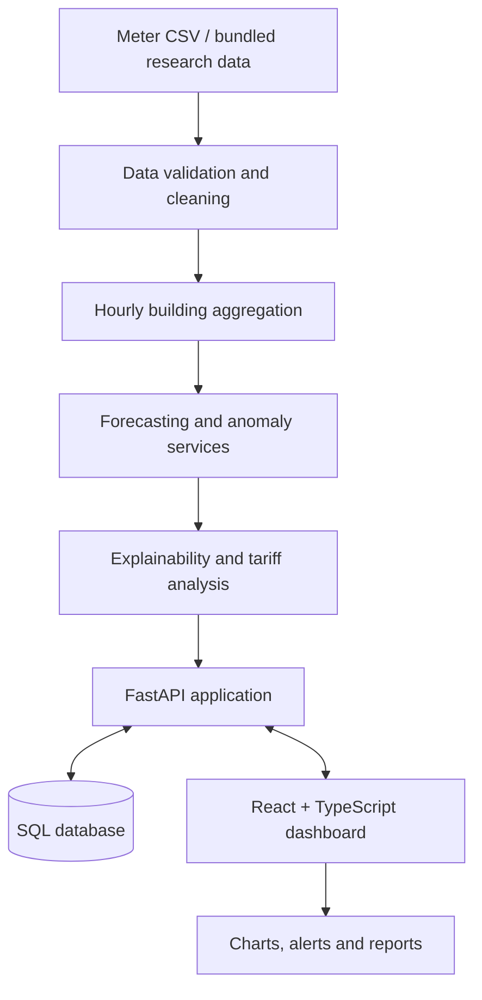

<div align="center">
  <h1>EnergiQ AI</h1>
  <p><strong>Intelligent Energy Forecasting, Anomaly Detection & Smart Energy Management</strong></p>
  <p>Forecast demand. Understand consumption. Make evidence-based decisions.</p>
  <p>
    
    
    
  </p>
</div>

---

## Overview

EnergiQ AI is an energy analytics and forecasting platform that turns meter readings into demand forecasts, anomaly signals, cost estimates and operational insights. Its current application focuses on **residential-community-level energy management**, aggregating hourly electricity readings across buildings and presenting forecasts, building comparisons, alerts and reports through a web interface.

The system combines a reproducible data pipeline, time-series machine learning, explainability methods and a full-stack application. It is designed to make the provenance of each number visible: raw readings, cleaned readings, aggregated demand and model predictions are treated as separate layers.

> **Dataset context:** the community research uses residential-labelled buildings from the public Building Data Genome Project 2 (BDG2). These are representative research communities, not metered Indian housing societies or individual family flats. The BDG2 residential/lodging category includes student residence halls. See the dataset limitations before interpreting the results.

## Core capabilities

| Capability | Description |
|---|---|
| Demand forecasting | Direct multi-horizon XGBoost forecasts for 1–24 hours, with an empirical 80% prediction band |
| Community analytics | Hourly aggregation, building comparisons, load profiles and demand distribution |
| Data quality | CSV ingestion, timestamp/unit handling, quality reports and documented cleaning rules |
| Anomaly detection | Causal same-hour-of-week baseline, flat-run rules and Isolation Forest corroboration |
| Explainability | TreeSHAP-based factors translated into readable explanations |
| Cost analysis | User-configurable tariff calculations and evidence-based recommendations |
| Scheduling | Cheapest-window scheduling logic available in the library/API |
| Reporting | PDF/CSV reports, charts, alerts and forecast error analysis |
| Platform services | Authentication, roles, background jobs, audit logging, monitoring and drift checks |

## Architecture



## Technology stack

- **Machine learning:** Python, XGBoost, scikit-learn, Random Forest, LSTM research benchmark, Isolation Forest
- **Forecasting and evaluation:** chronological hold-outs, expanding-window cross-validation, paired day-block bootstrap
- **Explainability:** TreeSHAP / XGBoost prediction contributions
- **Backend:** FastAPI, SQLAlchemy, Alembic, JWT-based role access
- **Frontend:** React, TypeScript, Vite, Tailwind CSS, Recharts
- **Data and operations:** SQLite, PostgreSQL 16, CSV pipelines, background jobs, audit logs

## Research results

### Household benchmark

The repository retains a research benchmark using the public UCI household electricity dataset. The held-out test period is 2010-01-01 to 2010-11-26. The best baseline was selected using cross-validation rather than the test set.

| Forecast horizon | Best baseline MAE (kW) | Random Forest MAE | XGBoost MAE | LSTM MAE |
|---|---:|---:|---:|---:|
| 1 hour | 0.4080 | 0.3334 | 0.3357 | 0.3533 |
| 6 hours | 0.5767 | 0.4354 | 0.4327 | 0.4383 |
| 24 hours | 0.5767 | 0.4415 | 0.4413 | 0.4414 |

Across the reported horizons, learned models improved on the selected baseline by approximately 18–25% under the project's paired day-block bootstrap evaluation. These household benchmark results should not be interpreted as accuracy on Indian residential societies.

### Community data verification

The packaged audit reports 103/103 checks for the independently recomputed BDG2 raw-data and aggregation checks. This verifies that the stored cleaned and aggregated values follow the documented processing rules; it does not prove the source dataset is error-free or representative of a real housing society.

## Run locally

### Requirements

- Python 3.11 recommended (3.12 and 3.13 are accepted by the launcher)
- Node.js 20.19 or newer for frontend development
- PostgreSQL 16 recommended for PostgreSQL integration testing; SQLite is supported for local development

### Quick start

The repository includes launchers:

```bash
# Linux / macOS
./run_project.sh

# Any platform
python run_energiq.py
```

On Windows, the packaged workflow is `RUN_PROJECT.bat`. The launcher creates a local environment, prepares the database and generates a unique administrator password on first start; see `.energiq-run/admin_login.txt` and [`START_HERE.md`](START_HERE.md).

### Manual developer setup

```bash
python -m venv .venv
# Activate the environment, then:
pip install -r requirements-dev.txt

# Configure a first administrator before starting the API
export ENERGIQ_ENV=dev
export ENERGIQ_ADMIN_EMAIL=admin@example.com
export ENERGIQ_ADMIN_PASSWORD='choose-a-long-password'

uvicorn backend.app.main:create_app --factory --reload --port 8000
```

In a second terminal:

```bash
cd frontend
npm ci
npm run dev
```

Follow [`START_HERE.md`](START_HERE.md) and [`docs/manuals/installation.md`](docs/manuals/installation.md) for complete setup, data import and troubleshooting instructions.

## Verification

The final packaged test report records the following results from a Linux verification environment (Python 3.11.15, Node 22.23):

| Check | Result |
|---|---:|
| Backend + ML tests (SQLite) | 293 passed, 3 skipped |
| Backend + ML tests (PostgreSQL 16) | 291 passed, 1 skipped, 0 failed |
| Frontend Vitest tests | 151 passed |
| Browser and functional flows | Passed across the documented page, routing, tariff, ML and chart checks |
| Accessibility scans | 31 axe-core scans, 0 violations |
| Independent BDG2 raw-data verification | 103 / 103 checks |

Run the main suites:

```bash
python -m pytest
cd frontend && npm test
```

Evidence and exact commands: [`FINAL_TEST_REPORT.md`](FINAL_TEST_REPORT.md), [`FINAL_FEATURE_AUDIT.md`](FINAL_FEATURE_AUDIT.md), and [`docs/15_verification_matrix.md`](docs/15_verification_matrix.md).

## Dataset and interpretation limitations

- BDG2 is a public building dataset; the seven research communities are aggregates of residential-labelled buildings, many of which are dormitories. They are **not** registered housing societies or individual family homes.
- Common facilities such as lifts, pumps and street lighting are not represented as separately metered facilities in the cited dataset.
- The tariff is user-configured/placeholder input; cost outputs are calculations from the selected tariff, not guaranteed savings.
- The anomaly dataset has no labelled faults. Alert counts are candidate events, not measured anomaly-detection accuracy.
- Forecasts are model estimates, not meter measurements.
- Docker images and containers, AWS resources, GitHub Actions CI, real Windows execution, macOS, and load behaviour were not verified in the packaged run. The project is a locally verified implementation, not a production cloud deployment.

See [`docs/13_limitations.md`](docs/13_limitations.md) and [`docs/society/08_limitations_and_future_work.md`](docs/society/08_limitations_and_future_work.md).

## Repository structure

```text
backend/       FastAPI application, services and migrations
frontend/      React + TypeScript dashboard
ml_engine/     Forecasting, anomaly, explainability and optimization modules
data/          Research data and sample inputs
scripts/       Reproduction, verification and maintenance tools
tests/         Unit, integration and end-to-end tests
docs/          Architecture, evaluation, manuals and verification evidence
docker/        Container definitions (runtime not verified)
```

## Further documentation

- [`START_HERE.md`](START_HERE.md) — quick start
- [`API_DOCUMENTATION.md`](API_DOCUMENTATION.md) — API overview
- [`FINAL_FEATURE_AUDIT.md`](FINAL_FEATURE_AUDIT.md) — feature-by-feature audit
- [`FINAL_TEST_REPORT.md`](FINAL_TEST_REPORT.md) — verification results and untested areas
- [`docs/society/README.md`](docs/society/README.md) — community dataset and research workflow

---

<div align="center"><strong>EnergiQ AI — Turning energy data into actionable intelligence.</strong></div>
