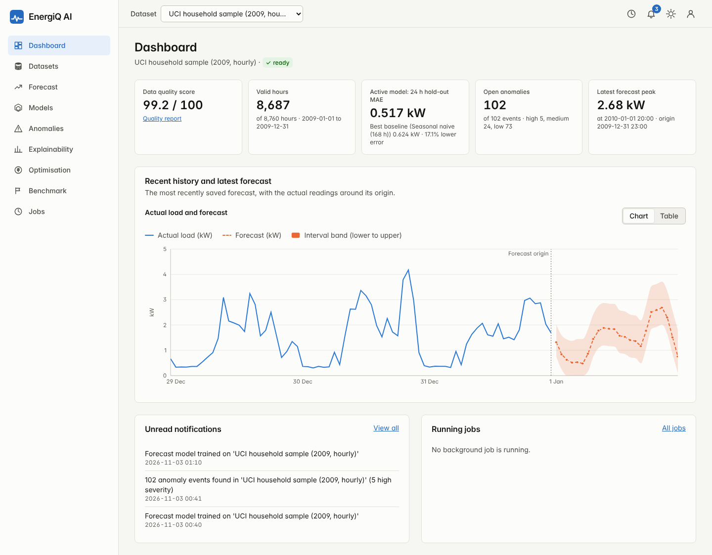

# EnergiQ AI

Cloud-Native Intelligent Energy Forecasting, Anomaly Detection & Optimization Platform
(M.Tech CSE major project)

A working web application and machine-learning library for hourly electricity data: upload a meter series, train a
forecasting model, forecast the next 1–24 hours with an uncertainty band, flag unusual hours, explain forecasts, price the
use under a tariff and find the cheapest time to run a flexible load. Developed on the public UCI household power
data set, with every reported number produced by code in this repository.



## Honest status

| Deployment level | Status |
|---|---|
| Implemented locally (SQLite or PostgreSQL 16, real server, real browser) | **Yes** |
| Docker-tested | **No**: Dockerfiles and compose file are written and validated, but the images were never built or run |
| Cloud-configured (AWS CloudFormation) | **Yes**: written and lint-clean |
| Actually deployed to AWS | **No**: nothing deployed, no cloud resources created |
| Independently verified / CI run on GitHub | **No**: the CI workflow has never run (not pushed) |

Everything was verified on Linux. **Not run on Windows**, although the instructions target it. See
[`docs/15_verification_matrix.md`](docs/15_verification_matrix.md) for what is PASS, PARTIAL and NOT TESTED, and
[`docs/13_limitations.md`](docs/13_limitations.md) for what a reader should not over-trust.

## What it does

| Area | Method | Where |
|---|---|---|
| Data | CSV upload, unit/time-convention handling, quality report, hourly aggregation (nothing imputed) | `ml_engine/data`, `backend/app/services/data.py` |
| Forecasting | Direct multi-horizon XGBoost (24 models, 1–24 h) with chronological hold-out, baselines, 80 % empirical band | `ml_engine/forecasting`, `backend/app/services/ml.py` |
| Research benchmark | Naive, seasonal naive, Random Forest, XGBoost, LSTM; expanding-window CV; day-block bootstrap | `scripts/`, `docs/06_model_evaluation.md` |
| Anomalies | Causal same-hour-of-week baseline with hour-of-day quantile band, flat-run rule, Isolation Forest corroboration | `ml_engine/anomaly`, `docs/08_anomaly_detection.md` |
| Explainability | Exact TreeSHAP (XGBoost `pred_contribs`) grouped into plain-language factors | `ml_engine/explainability` |
| Optimisation | Tariff cost, rule-based recommendations with evidence, cheapest-window scheduler | `ml_engine/optimization` |
| Platform | FastAPI + SQLAlchemy + Alembic, JWT auth with roles, background jobs, audit log, monitoring and drift checks | `backend/` |
| Interface | React + TypeScript + Vite + Tailwind + Recharts, API data only | `frontend/` |

### Headline research results (UCI data, test period 2010-01-01 to 2010-11-26, scored once)

Test MAE in kW (mean load 1.055 kW); lower is better. Best baseline chosen by cross-validation, not by test score.

| Horizon | Best baseline | Random Forest | XGBoost | LSTM |
|---|---|---|---|---|
| 1 h | 0.4080 (naive) | 0.3334 | 0.3357 | 0.3533 |
| 6 h | 0.5767 (seasonal 168 h) | 0.4354 | 0.4327 | 0.4383 |
| 24 h | 0.5767 (seasonal 168 h) | 0.4415 | 0.4413 | 0.4414 |

All learned models beat the baseline at every horizon (paired day-block bootstrap, 95 % intervals exclude zero) by about 18–25 %.
The three model families are close to each other: the LSTM is worse than XGBoost at 1 h and indistinguishable at 6 and 24 h, so the
simpler XGBoost is the deployed model. Explained variance at 6 and 24 h is only about 0.40. Anomaly detection has **no
accuracy figure** because the data has no fault labels. XGBoost numbers depend on the XGBoost version (the results were
regenerated under the pinned environment; see `docs/06_model_evaluation.md` §8).

## Quick start (Windows PowerShell; Linux/macOS notes in the manual)

Requirements: Python 3.11, Node 22 LTS, Git. Full instructions: [`docs/manuals/installation.md`](docs/manuals/installation.md).

```powershell
git clone <your repository URL> EnergiQ-AI ; cd EnergiQ-AI
python -m venv .venv ; .venv\Scripts\Activate.ps1
pip install -r requirements-dev.txt

$env:ENERGIQ_ENV = "dev"
uvicorn backend.app.main:create_app --factory --reload --port 8000     # terminal 1

cd frontend ; npm ci ; npm run dev                                     # terminal 2 → http://localhost:5173
```

Register, choose *Datasets → Load bundled sample dataset*, then *Models → Train a new model*. The user guide is
[`docs/manuals/user_guide.md`](docs/manuals/user_guide.md); a 12-minute demonstration script is in
[`docs/manuals/demo_script.md`](docs/manuals/demo_script.md).

## Tests

```powershell
python -m pytest tests\unit tests\integration         # 128 tests (2 more need PostgreSQL)
cd frontend ; npm test                                 # 122 tests
python -m pytest tests\e2e -rs                         # real server + real browser (needs `npm run build` and Playwright's Chromium)
```

Last full run (Linux, Python 3.11): 131 passed and 2 skipped for the Python suites (95 % line coverage of `backend/` and
`ml_engine/`), 46 of 46 integration tests on PostgreSQL 16, 122 of 122 frontend tests; ruff, bandit (medium+), pip-audit,
cfn-lint and the secret scan clean. Details and exclusions: [`docs/11_testing.md`](docs/11_testing.md).

## Repository layout

```
backend/            FastAPI application, Alembic migrations
ml_engine/          Framework-free ML library (data, features, forecasting, anomaly, explainability, optimisation)
frontend/           React application and its tests
scripts/            Research pipeline (reproduce_benchmark.py and its steps), report/diagram/API-doc generators, backup, secret scan
tests/              unit, integration (incl. security), e2e (HTTP and browser)
docker/, docker-compose.yml        Container definitions (not built here)
infrastructure/aws/                CloudFormation templates (not deployed)
.github/workflows/                 CI and a manual-only deployment workflow (never run)
artifacts/reports/                 Committed benchmark, EDA, anomaly and explainability results (with library versions)
data/sample/                       One-year sample of the UCI data used for the bundled demo dataset
docs/                              Numbered technical documents, academic chapters, manuals, diagrams, screenshots
```

## Documents

| Topic | File |
|---|---|
| Dataset suitability, requirements, architecture, EDA | `docs/01`–`docs/04` |
| ML methodology, evaluation, explainability/optimisation, anomalies | `docs/05`–`docs/08` |
| Backend and API, security, testing | `docs/09`, `docs/10`, `docs/11` (API reference: `docs/api/`) |
| Deployment, limitations, MLOps and monitoring | `docs/12`, `docs/13`, `docs/14` |
| Verification matrix, frontend | `docs/15`, `docs/16` |
| Abstract, problem statement, objectives, literature review, final report | `docs/academic/` |
| Installation, user guide, demonstration script | `docs/manuals/` |
| References (17, each checked) | `docs/references.md` |

## Reproducing the research results

The raw UCI file (127 MB) is not committed. Download it from https://doi.org/10.24432/C58K54, place it at
`data\raw\uci_household_power\household_power_consumption.txt`, install `requirements-research.txt` and run
`python scripts\reproduce_benchmark.py --input <that file>` (about 25 minutes on 2 CPU cores). Use the pinned
environment: every result file records the library versions that produced it.

## Data and licence of the data

UCI *Individual Household Electric Power Consumption* (Hebrail & Berard), CC BY 4.0, DOI 10.24432/C58K54. Please cite the
data set when using results derived from it. No licence has been chosen for the project's own code yet; add one before
publishing the repository.
