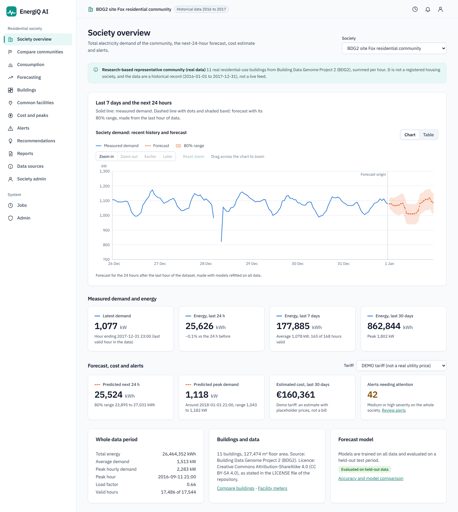

# EnergiQ AI - Intelligent Energy Forecasting & Smart Society Management

Cloud-Native Intelligent Energy Forecasting, Anomaly Detection & Optimization Platform


**Now extended to the society level: Residential Society Electricity Consumption Prediction and Smart Energy Management.**
The platform forecasts the **total hourly electricity demand of a residential community** (several buildings, summed per hour
from real meter data), compares buildings, raises alerts for unusual demand, estimates cost under a configurable tariff,
gives evidence-based recommendations and produces PDF/CSV reports. An administrator can upload the meter file of a real society.
The first stage of the project (single-meter household forecasting, anomalies, SHAP, optimisation, benchmark) no longer has web pages: they were removed from the interface. Its API routes, ML library, tests and research benchmark are still in the repository.

> **Data, in one honest sentence:** no open dataset of a registered housing society with per-building and common-facility meters
> was available, so the societies here are *research-based representative communities*: the real residential-use buildings of seven sites
> of the public Building Data Genome Project 2, summed per hour (73 buildings, CC BY-SA 4.0). **BDG2's `Lodging/residential` label includes
> student residence halls (56 of the 73 buildings are labelled `Dormitory`); the data are not family-flat data and not data of a registered housing society.**
> Nothing is simulated or filled in. See [Dataset limitations](#dataset-limitations) below and [`docs/society/`](docs/society/README.md) (start there), including the
> [generated results](docs/society/RESULTS.md), the [limitations](docs/society/08_limitations_and_future_work.md) and the
> [independent raw-data verification](docs/society/10_raw_data_verification.md).

The household part was developed on the public UCI household power data set; every reported number is produced by code in this repository.

**New here? Start with [`START_HERE.md`](START_HERE.md)** (run it on Windows in a few clicks). What was checked and what was repaired in the final upgrade: [`FINAL_FEATURE_AUDIT.md`](FINAL_FEATURE_AUDIT.md) (every feature, with evidence), [`FINAL_TEST_REPORT.md`](FINAL_TEST_REPORT.md) (every test run, with the exact command and result, and what could not be tested), [`BUGS_FIXED.md`](BUGS_FIXED.md), [`UI_UX_IMPROVEMENTS.md`](UI_UX_IMPROVEMENTS.md) and [`API_DOCUMENTATION.md`](API_DOCUMENTATION.md).



*Society overview on real data (BDG2 Fox community: 11 residential buildings summed per hour), final version. Screenshots of every page at desktop, tablet and phone width are in [`docs/screenshots/final/`](docs/screenshots/final/).*

## Honest status

| Deployment level | Status |
|---|---|
| Implemented locally (SQLite or PostgreSQL 16, real server, real browser) | **Yes** |
| Docker-tested | **No**: Dockerfiles and compose file are written and statically validated, but **no image was built and no container was run**. A build of both images was attempted and stopped before the first Dockerfile instruction: Docker Hub answered `Forbidden` when the base images (`python:3.11-slim`, `node:22-alpine`) were looked up from the verification workspace ([`docs/12_deployment.md`](docs/12_deployment.md) §1b) |
| Cloud-configured (AWS CloudFormation) | **Yes**: written and lint-clean |
| Actually deployed to AWS | **No**: nothing deployed, no cloud resources created |
| Independently verified / CI run on GitHub | **No**: the CI workflow has never run (not pushed) |
| Windows start scripts (`RUN_PROJECT.bat`, `STOP_PROJECT.bat`, `CHECK_ENVIRONMENT.bat`) | **Written, structure-checked and followed through by a simulator, but never run on Windows** (no Windows computer was available; the launcher they start was run for real on Linux). A one-click GitHub Windows test, [`.github/workflows/windows-launcher.yml`](.github/workflows/windows-launcher.yml), is written but has never run. [`START_HERE.md`](START_HERE.md) gives the same steps by hand |

**This is a locally verified implementation, not a production deployment.** What was run in place of a container: the API in production mode against a real PostgreSQL 16 server, started with the image's entrypoint script and file layout (no container).
**Still unverified:** the Docker runtime (image builds, `docker compose up`, the container's non-root user and volume permissions), the Nginx configuration, every AWS resource (ECS, EFS, RDS, ALB, Secrets Manager; the templates passed `cfn-lint` only), GitHub Actions CI (never run), Windows and macOS, and behaviour under load.

Everything was verified on Linux. **Not run on Windows** (and not on Node 26), although the instructions target it. See
[`docs/15_verification_matrix.md`](docs/15_verification_matrix.md) for what is PASS, PARTIAL and NOT TESTED, and
[`docs/13_limitations.md`](docs/13_limitations.md) for what a reader should not over-trust.

## Dataset limitations

Read this before using any society number.

* **What the buildings are.** The seven communities (Bull, Eagle, Fox, Hog, Peacock, Rat, Robin) are groups of whole-building electricity meters of BDG2 buildings whose primary use is `Lodging/residential`. This label **includes student residence halls**.
  By the BDG2 sub-use label: **56 `Dormitory`**, 8 `Housing` (all of Eagle), 9 `Other - Lodging/Residential` (all of Rat). BDG2 does not describe the last two further, so they are not claimed to be family flats either.
* **What they are not.** They are **not** data of family flats, **not** data of individual homes and **not** data of a registered housing society. Occupancy patterns of family housing (cooking peaks, school and office times, festivals, air-conditioner loads in Indian homes) differ, so accuracy figures do not transfer.
  Lifts, water pumps, street lighting and a clubhouse are not metered in this data; the Facilities page says so. The tariff is a placeholder, and there are no fault labels, so alerts cannot be scored.
* **Four layers, never mixed.** (1) *Raw readings*: BDG2 `electricity.csv` as published. (2) *Cleaned readings*: the raw readings with invalid ones set to missing; nothing is changed or filled. (3) *Aggregated community demand*: the hourly sum of the cleaned readings of the kept buildings, missing wherever any of them is missing.
  (4) *ML predictions*: forecasts of layer 3 by trained models; estimates, not measurements.
* **What was checked, and what was not.** A separate program that imports nothing from the application re-computes layers 2 and 3 from the raw files (SHA-256 checked) and compares them with the stored data and the running API:
  **127 of 127 checks passed** ([report](docs/society/VERIFICATION_REPORT.md), [method, rejected sites and thresholds](docs/society/10_raw_data_verification.md)). That shows the stored numbers follow from the raw files by the documented rules.
  It does not verify layer 4, does not show that BDG2 is free of errors, and does not make the communities representative of any real society.
* **Sites left out.** Of the 13 BDG2 sites with a residential-labelled building, 7 form a community. Bear, Bobcat, Lamb and Mouse have too few residential buildings (4, 3, 1, 0; 8 are needed); Cockatoo and Panther have 27 candidates each but no meter reaches 95 % valid hours.

```bash
python scripts/verify_society_raw_data.py --use-subset      # re-run the checks on the shipped raw subset (a few seconds, no download)
python scripts/verify_society_end_to_end.py --check-subset  # full run incl. a throw-away API; rewrites the report (needs the full BDG2 files: --download)
```

## What it does

| Area | Method | Where |
|---|---|---|
| Data | CSV upload, unit/time-convention handling, quality report, hourly aggregation (nothing imputed) | `ml_engine/data`, `backend/app/services/data.py` |
| Forecasting | Direct multi-horizon XGBoost (24 models, 1–24 h) with chronological hold-out, baselines, 80 % empirical band | `ml_engine/forecasting`, `backend/app/services/ml.py` |
| Research benchmark | Naive, seasonal naive, Random Forest, XGBoost, LSTM; expanding-window CV; day-block bootstrap | `scripts/`, `docs/06_model_evaluation.md` |
| Anomalies | Causal same-hour-of-week baseline with hour-of-day quantile band, flat-run rule, Isolation Forest corroboration | `ml_engine/anomaly`, `docs/08_anomaly_detection.md` |
| Explainability | Exact TreeSHAP (XGBoost `pred_contribs`) grouped into plain-language factors | `ml_engine/explainability` |
| Optimisation | Tariff cost, rule-based recommendations with evidence, cheapest-window scheduler (library and API; no web page since the single-meter pages were removed) | `ml_engine/optimization` |
| **Society data** | BDG2 residential buildings → cleaned meters → exact hourly society sum (missing unless every meter is valid); CSV upload with facility mapping | `ml_engine/society/{sources,cleaning,aggregate,ingest}.py` |
| **Society forecasting** | Naive / seasonal naive / linear / Random Forest / XGBoost (+ observed weather), 1, 6, 12, 24 h and 7 days, expanding-window CV, test scored once, bootstrap vs. baseline, daily-peak evaluation | `ml_engine/society/{experiment,runner,deploy,serving}.py`, `docs/society/04_models_and_evaluation.md` |
| **Society analytics** | Buildings, facilities (when metered), cost with user-entered tariffs, load-duration curve and demand distribution, alerts per society/building, recommendations, SHAP, forecast error analysis, side-by-side comparison of the seven communities, PDF/CSV reports | `backend/app/api/societies.py`, `frontend/src/pages/society/` |
| Platform | FastAPI + SQLAlchemy + Alembic, JWT auth with roles, background jobs, audit log, monitoring and drift checks | `backend/` |
| Interface | React + TypeScript + Vite + Tailwind + Recharts, API data only | `frontend/` |

### Headline research results (UCI data, test period 2010-01-01 to 2010-11-26, scored once)

Test MAE in kW (mean load 1.055 kW); lower is better. Best baseline chosen by cross-validation, not by test score.

| Horizon | Best baseline | Random Forest | XGBoost | LSTM |
|---|---|---|---|---|
| 1 h | 0.4080 (naive) | 0.3334 | 0.3357 | 0.3533 |
| 6 h | 0.5767 (seasonal 168 h) | 0.4354 | 0.4327 | 0.4383 |
| 24 h | 0.5767 (seasonal 168 h) | 0.4415 | 0.4413 | 0.4414 |

All learned models beat the baseline at every horizon (paired day-block bootstrap, 95 % intervals exclude zero) by about 18–25 %.
The three model families are close to each other: the LSTM is worse than XGBoost at 1 h and indistinguishable at 6 and 24 h, so the
simpler XGBoost is the deployed model. Explained variance at 6 and 24 h is only about 0.40. Anomaly detection has **no
accuracy figure** because the data has no fault labels. XGBoost numbers depend on the XGBoost version (the results were
regenerated under the pinned environment; see `docs/06_model_evaluation.md` §8).

## Quick start

**Windows (recommended):** unzip to a short folder such as `C:\EnergiQ` (right-click the ZIP, Properties, tick *Unblock*, then Extract All), then double-click **`RUN_PROJECT.bat`**. It checks Python and Node.js, creates the Python environment, installs what is missing (first start: 3 to 10 minutes, internet needed once), prepares the database, starts the backend and the web app, waits until both really answer, opens the app in your browser and prints the sign-in. Needs Python 3.11 (3.12 or 3.13 also accepted) and Node.js 20.19 or newer; no administrator rights. `STOP_PROJECT.bat` stops it; `CHECK_ENVIRONMENT.bat` checks your computer and changes nothing. Logs are kept in `.energiq-run`. Step by step, troubleshooting (including the "Smart App Control" block) and the same steps by hand: [`START_HERE.md`](START_HERE.md). **The `.bat` files have not been run on a real Windows computer** (see [`FINAL_TEST_REPORT.md`](FINAL_TEST_REPORT.md) section 8).

**Linux / macOS:** `./run_project.sh` (same launcher). **Any system:** `python run_energiq.py` (Windows: `py -3.11 run_energiq.py`).

Every installation makes its own random administrator password on the first start and keeps it in `.energiq-run/admin_login.txt`; there is no shared default. The launcher needs only the Python standard library.

By hand, for developers (PowerShell):

```powershell
python -m venv .venv ; .venv\Scripts\Activate.ps1
pip install -r requirements-dev.txt

$env:ENERGIQ_ENV = "dev"
$env:ENERGIQ_ADMIN_EMAIL = "admin@example.com"                           # creates the administrator on the first start
$env:ENERGIQ_ADMIN_PASSWORD = "choose-a-long-password-1"
uvicorn backend.app.main:create_app --factory --reload --port 8000     # terminal 1

cd frontend ; npm ci ; npm run dev                                     # terminal 2 -> http://localhost:5173
```

Sign in as that administrator, open *Society admin, Import bundled communities* (a background job; the *Jobs* page shows its progress), then *Society overview*.
All seven communities load and all seven ship with their deployed forecasting models, so the live forecast works for each of them.
The single-meter pages (sample dataset, model training) no longer exist in the interface. The user guide is
[`docs/manuals/user_guide.md`](docs/manuals/user_guide.md); a 12-minute demonstration script is in
[`docs/manuals/demo_script.md`](docs/manuals/demo_script.md); the API is documented in [`API_DOCUMENTATION.md`](API_DOCUMENTATION.md) and, generated from the code, in [`docs/api/API_REFERENCE.md`](docs/api/API_REFERENCE.md).

## Tests

Final results of the upgrade (Linux sandbox, Python 3.11.15, Node 22.23; commands, logs and what was not run are in [`FINAL_TEST_REPORT.md`](FINAL_TEST_REPORT.md)):

| Check | Result |
|---|---|
| Backend and ML, SQLite (`python -m pytest -q -rs`) | **293 passed, 3 skipped** (baseline before the upgrade: 256 passed, 3 skipped) |
| Backend and ML, PostgreSQL 16.15 (unit and integration) | **291 passed, 1 skipped, 0 failed** |
| Frontend (`npm test`, Vitest 5) | **151 passed** (baseline: 118) |
| Type check, ESLint, production build, ruff | clean |
| Browser checks of the real app (48 page visits, 11 routing flows, 11 functional flows, 13 tariff flows, 24 ML checks, 18 charts) | all passed; 0 console errors |
| Accessibility (axe-core, 31 scans) | 0 violations |
| Security and dependency scans | secret scan 0 findings; `pip-audit` none; `npm audit --omit=dev` 0; bandit 0 medium or high (12 low, explained); 7 moderate advisories remain in the code-linter packages and are not part of the app |
| Independent raw-data verification of the data (official BDG2 files) | 103 of 103 checks |

```powershell
python -m pytest                    # SQLite; the 3 skips need PostgreSQL (2) or the 194 MB BDG2 files (1)
cd frontend ; npm test
```

The PostgreSQL run uses `ENERGIQ_TEST_DATABASE_URL=postgresql+psycopg://...`. The 4 end-to-end tests (real server and real Chromium; need `npm run build` and Playwright's Chromium) ran on SQLite only. Society testing, what each file proves and what was **not** tested: [`docs/society/07_testing_and_verification.md`](docs/society/07_testing_and_verification.md).

**Not tested:** the Windows start scripts on a real Windows computer, Node 26, Docker, AWS, GitHub Actions, macOS, other browsers than Chromium, load behaviour.

Records of the previous delivery (before this upgrade) are kept unchanged because they describe that ZIP: [`docs/postgres_test_run.txt`](docs/postgres_test_run.txt), [`docs/postgres_test_run_clean_unzip.txt`](docs/postgres_test_run_clean_unzip.txt), and the household-stage coverage figures in [`docs/11_testing.md`](docs/11_testing.md). The evidence for this upgrade (logs, the scripts that drove the browser, raw audit results) is in [`docs/final_verification/`](docs/final_verification/).

## Repository layout

```
backend/            FastAPI application, Alembic migrations
ml_engine/          Framework-free ML library (data, features, forecasting, anomaly, explainability, optimisation)
frontend/           React application and its tests
scripts/            Research pipeline (reproduce_benchmark.py and its steps), report/diagram/API-doc generators, backup, secret scan
tests/              unit, integration (incl. security), e2e (HTTP and browser)
docker/, docker-compose.yml        Container definitions (no image has been built)
infrastructure/aws/                CloudFormation templates (not deployed)
.github/workflows/                 CI and a manual-only deployment workflow (never run)
artifacts/reports/                 Committed benchmark, EDA, anomaly and explainability results (with library versions)
data/sample/                       One-year sample of the UCI data used for the bundled demo dataset
data/society/processed/            Cleaned meters and community demand of the seven BDG2 communities (layers 2 and 3)
data/society/raw_subset/           Raw BDG2 readings of the residential-labelled buildings and the official metadata, unchanged, with SHA-256 manifest (layer 1)
docs/                              Numbered technical documents, academic chapters, manuals, diagrams, screenshots
docs/final_verification/            Logs, browser-test scripts and raw audit results of the final upgrade
RUN_PROJECT.bat, STOP_PROJECT.bat, CHECK_ENVIRONMENT.bat, run_energiq.py   One-click start on Windows (and the shell equivalents)
```

## Documents

| Topic | File |
|---|---|
| Dataset suitability, requirements, architecture, EDA | `docs/01`–`docs/04` |
| ML methodology, evaluation, explainability/optimisation, anomalies | `docs/05`–`docs/08` |
| Backend and API, security, testing | `docs/09`, `docs/10`, `docs/11` (API reference: `docs/api/`) |
| Deployment, limitations, MLOps and monitoring | `docs/12`, `docs/13`, `docs/14` |
| Verification matrix, frontend | `docs/15`, `docs/16` |
| Abstract, problem statement, objectives, literature review, final report | `docs/academic/` |
| Run it, step by step | [`START_HERE.md`](START_HERE.md), `docs/manuals/installation.md` |
| What works, what was fixed, how it was tested | [`FINAL_FEATURE_AUDIT.md`](FINAL_FEATURE_AUDIT.md), [`BUGS_FIXED.md`](BUGS_FIXED.md), [`FINAL_TEST_REPORT.md`](FINAL_TEST_REPORT.md), [`UI_UX_IMPROVEMENTS.md`](UI_UX_IMPROVEMENTS.md) |
| API | [`API_DOCUMENTATION.md`](API_DOCUMENTATION.md), `docs/api/` |
| Installation, user guide, demonstration script | `docs/manuals/` |
| Society data card, method, results, limits, viva notes | `docs/society/` (start with its `README.md`) |
| Independent raw-data verification (method, rejected sites, thresholds, generated report) | `docs/society/10_raw_data_verification.md`, `docs/society/VERIFICATION_REPORT.md` |
| References (17, each checked) | `docs/references.md` |

## Reproducing the research results

The raw UCI file (127 MB) is not committed. Download it from https://doi.org/10.24432/C58K54, place it at
`data\raw\uci_household_power\household_power_consumption.txt`, install `requirements-research.txt` and run
`python scripts\reproduce_benchmark.py --input <that file>` (about 25 minutes on 2 CPU cores). Use the pinned
environment: every result file records the library versions that produced it.

## Data and licence of the data

UCI *Individual Household Electric Power Consumption* (Hebrail & Berard), CC BY 4.0, DOI 10.24432/C58K54. Please cite the
data set when using results derived from it. No licence has been chosen for the project's own code yet; add one before
publishing the repository.
