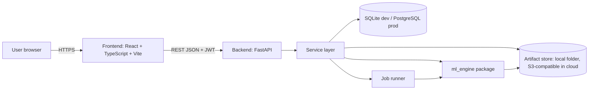

# EnergiQ AI — Architecture (as built)

Originally written as the Phase 1 design and updated after implementation: sections marked
*(as built)* describe what exists and was tested; where the build departed from the plan the
text says so. Rendered diagrams are in `docs/diagrams/`; the detailed backend description is
`docs/09_backend_and_api.md`.

## 1. System overview



The ML code lives in its own package (`ml_engine`) with no web dependencies, so
it can be tested, run from scripts and called by the backend without coupling.

## 2. Technology choices

| Layer | Choice | Reason |
|---|---|---|
| Frontend | React, TypeScript, Vite, Tailwind CSS, Recharts | Per spec |
| Backend | Python 3.11, FastAPI, Pydantic, SQLAlchemy, Alembic | Per spec |
| Database | SQLite for local, PostgreSQL for production, same SQLAlchemy models | Per spec; keeps laptop light |
| Auth | argon2id password hashing, HS256 JWT access tokens, role-based authorisation (*as built*) | Standard, no extra service |
| Forecasting | Naive and seasonal naive, Random Forest, XGBoost, small PyTorch LSTM (CPU) | Per spec; baselines first |
| Anomaly detection | Causal hour-of-week baseline with empirical per-hour band, flat-run rule and Isolation Forest corroboration (*as built*, `docs/08_anomaly_detection.md`) | Per spec; no labels exist |
| Explainability | Exact TreeSHAP (XGBoost `pred_contribs`) for the tree models; the LSTM is not explained (*as built*) | TreeSHAP is exact for tree ensembles; SHAP on an LSTM is costly on CPU |
| Experiment tracking | Tables in the main database plus JSON run reports (*as built*; no MLflow) | MLflow server is an extra service; revisit if needed |
| Background jobs | Job table plus in-process thread pool (*as built*; Celery/Redis not implemented) | Avoids Redis on an 8 GB laptop (NFR-03); consequence: one API process (`docs/13_limitations.md`) |
| Tests | pytest, Vitest, Playwright | Per spec |
| CI/CD | GitHub Actions | Per spec |

## 3. Repository layout

```
EnergiQ-AI/
  frontend/            React + TypeScript app
  backend/app/         FastAPI app: api, models, schemas, security, services; backend/migrations (Alembic)
  ml_engine/
    data/              ingestion, validation, resampling, quality scoring
    features/          calendar, lag and rolling features
    forecasting/       baselines, Random Forest, XGBoost, LSTM
    anomaly/           Isolation Forest, rolling statistics
    explainability/    SHAP and importance
    evaluation/        metrics, backtests, plots, reports
  data/raw|processed|sample   raw data is never committed
  artifacts/models|reports    trained models; reports and profiles
  tests/unit|integration|e2e
  docs/  scripts/  docker/  infrastructure/aws  .github/workflows/
```

## 4. ML data flow

1. Ingest: chunked read, parse timestamps, map the missing markers (`?` and
   empty), sort, de-duplicate, quality score.
2. Resample to hourly mean, keeping only hours with enough valid minutes.
3. Chronological split; fit scalers on training data only.
4. Features: calendar, lags, rolling statistics (shifted so no future value is used).
5. Train and compare baselines, Random Forest, XGBoost and LSTM per horizon.
6. Evaluate on the held-out test split only; save metrics, plots, model
   artifact, data hash and config as a versioned run.
7. Score anomalies and compute explanations from the saved model.

## 5. Backend modules and endpoints (as built: `docs/api/API_REFERENCE.md`)

| Area | Endpoints |
|---|---|
| Auth | register, login, current user |
| Datasets | upload, list, detail, quality report, readings, delete |
| Forecasts | create run, list, detail, compare |
| Anomalies | run detection, list with severity, acknowledge |
| Explainability | global importance, local explanation for a prediction |
| Optimisation | tariffs (CRUD), cost estimate, recommendations |
| Reports | downloadable HTML report per dataset; CSV export of a forecast |
| Models | list versions, evaluation results, activate, delete, monitoring (drift, realised error) |
| Admin | users, audit events |
| Health | liveness and readiness |

## 6. Database entities (as built: 12 tables, `docs/diagrams/er_diagram.png`)

users, datasets, readings, jobs, model_versions, forecasts, anomaly_runs, anomalies, tariffs,
recommendation_snapshots, notifications, audit_events. Roles are a column on `users`; dataset
metadata, ingestion reports and evaluation results are JSON columns on their parent rows.
Alembic migration `0001` (checked against the models on SQLite and PostgreSQL), with indexes
on owner for every user-scoped table and on (dataset, timestamp) for readings and anomalies.

Energy readings are stored at the hourly canonical resolution; the raw 1-minute
file stays on disk, not in the database, to keep SQLite small.

## 7. Security approach (as built: `docs/10_security.md`)

Per-user ownership checks on every dataset-scoped query; upload size and type
limits with content validation; parameterised queries via SQLAlchemy; CORS
restricted by environment; rate limiting on auth and upload routes; secrets from
environment variables only; audit events for logins, uploads and deletions.
Dependency vulnerability scanning in CI.

## 8. Deployment status ladder

| Level | Status |
|---|---|
| Implemented locally | Yes: ML engine, API, web UI; tested on Python 3.11 with SQLite and PostgreSQL 16 |
| Docker-tested | **No**: Dockerfiles and compose file written; images not built here (base-image registry unreachable from the workspace) |
| Cloud-configured | Yes: CloudFormation templates (cfn-lint clean) and GitHub Actions workflows; never executed |
| Actually deployed | **No** |
| Independently verified | **No** |

No cloud resources were created. Details: `docs/12_deployment.md`.

## 9. Key decisions and open questions

| Decision | Status |
|---|---|
| Primary target is `Global_active_power`, aggregated hourly | Confirmed in Phase 2 |
| Hour is valid with at least 45 valid minutes | Confirmed in Phase 2 |
| Test split 2010-01-01 to 2010-11-26 | Confirmed in Phase 2 |
| Validation: expanding-window time-series CV instead of one July–December block | Adopted (8 quarterly folds, `docs/05_ml_methodology.md`) |
| Celery and Redis deferred | Not implemented; in-process job pool used (limitation recorded) |
| Public-holiday calendar feature | Not implemented (no documented source); listed as future work |
| LSTM explanation method | Decided: not explained; XGBoost is the explained production model |
