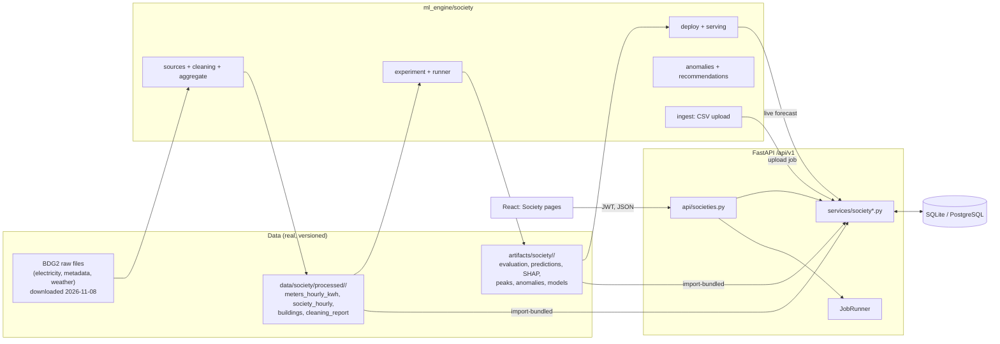

# 1. Architecture

The society system is added to the existing EnergiQ AI stack without replacing it: the same FastAPI application, the same
authentication and roles, the same job runner, audit log and database, the same React shell. New code is in separate modules
and the household API routes, ML library and benchmark still work; their web pages (the "Single-meter tools" group) were removed from the interface in a later change.

## Layers and where the code is

| Layer | Modules | Responsibility |
|---|---|---|
| Data acquisition | `ml_engine/society/sources.py`, `scripts/society_prepare.py` | Download BDG2 files, record URL, size and SHA-256, select residential buildings and sites |
| Cleaning and aggregation | `ml_engine/society/cleaning.py`, `aggregate.py` | Per-meter validity rules; society total = sum of the meters, missing unless every meter is valid |
| Experiment | `ml_engine/society/experiment.py`, `runner.py` | Features, models, expanding-window cross-validation, one-shot test, bootstrap, peak evaluation, SHAP |
| Deployment | `ml_engine/society/deploy.py`, `serving.py` | Refit on all data for 24 hourly horizons and 168 h, save with the model registry, serve live forecasts with an 80 % band |
| Anomalies and advice | `ml_engine/society/anomalies.py`, `recommendations.py` | Whole-society and per-building alerts with explanations; rule-based recommendations with evidence |
| Upload | `ml_engine/society/ingest.py` | Read an admin's wide CSV (1–60 min), map buildings and facilities, same cleaning rules |
| API | `backend/app/api/societies.py`, `services/society.py`, `society_import.py`, `society_reports.py` | 25 routes, role checks, privacy, jobs, PDF/CSV reports |
| Database | `backend/app/models.py`, Alembic `0002` | Societies, buildings, meters, consumption records, hourly society totals, model records, forecast results, anomaly events, reports |
| Interface | `frontend/src/pages/society/*`, `components/society/*`, `state/SocietyContext.tsx` | Eleven pages that read only API data |

## Interface design

One light theme, built from design tokens (`frontend/src/index.css`, exposed as Tailwind colour names), so a colour is changed once and not per screen.
Colours follow one palette (page `#F8FAFC`, navy ink `#0F172A`, teal brand `#0D9488`, blue `#2563EB`, slate secondary text `#64748B`, borders `#E2E8F0`). Where the brand teal is too pale for text (white on `#0D9488` is 3.7 : 1, below the 4.5 : 1 that WCAG AA asks for) buttons and links use the darker `#0F766E` (5.5 : 1); the logo and chart lines keep `#0D9488`.
Type is IBM Plex Sans (SIL Open Font Licence), bundled through `@fontsource/ibm-plex-sans` at three weights (about 72 KB), so the app makes no request to a font service.
The side navigation is a white panel with the current page marked in teal; the top bar names the society and the period the data cover.
The overview leads with the chart (the last seven days and the next 24 hours), then the measured numbers, then forecast, cost and alerts; a tile that shows a
forecast carries a dashed marker and a measured one a solid marker, matching the chart lines. Charts keep the rules of the household stage (one y-axis, a legend for two
or more series, a Chart/Table switch on every chart, status never by colour alone). The line that says the data are a research-based representative community and not
a live feed stays on every society page. The tariff is always labelled as a demo estimate. The sign-in and registration pages share one split-screen frame (`components/auth/AuthShell.tsx`): brand, headline and a real forecast figure on the left, the form on the right; on tablets and phones the form comes first with compact branding. The figure is drawn from a week of the Fox held-out test period (the week of median error), generated by `scripts/make_login_chart_data.py`, because the page is shown before sign-in and the API needs a login. Accessibility is checked automatically with `scripts/ui_audit.py` (see `07_testing_and_verification.md`).

## How the pieces talk

* **Bundled communities.** `scripts/society_prepare.py` (data) and `scripts/society_train.py` (models) run offline and write
  `data/society/processed` and `artifacts/society`. An administrator's *Import bundled communities* job loads them into the
  database: meters, hourly readings, building and society totals, the stored evaluation, predictions for backtests and the anomaly events.
* **Live numbers.** Overview, consumption, buildings, peaks and cost are computed from the database rows on each request.
  The forecast is computed on request from the deployed models in `artifacts/society/<key>/models` and the last hours of the stored series.
* **Evaluation vs. deployment.** The evaluation files can be loaded without the deployed models (they are large); in that case
  the model comparison, backtests, peak evaluation and SHAP pages work and the live forecast answers HTTP 410
  ("models not installed on this server"). The overview shows "Not available" instead of a number.
* **Uploads.** `POST /admin/societies/upload` validates the file synchronously (format, size, columns) and starts a job that
  cleans, aggregates, stores and detects anomalies. *Train models* then runs the same evaluation protocol as the bundled communities.
* **No synthetic data path exists.** The code has no random-data generator for societies; tests that need arrays build tiny
  hand-written ones and say so, and the API tests read the real processed files.

## Roles

`viewer` (read), `analyst` (read, acknowledge alerts, create reports), `admin` (everything, plus import, upload, train, delete,
meter management, and the dataset-identifier fields). Self-registration creates `analyst`; the administrator is seeded from the environment.
